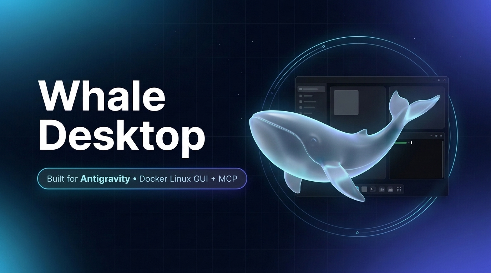

<div align="center">



# Whale Desktop

**เดสก์ท็อป Linux แยกตัวใน Docker สำหรับใช้งานร่วมกับ Antigravity IDE บน Windows**

[-0078D6?style=for-the-badge&logo=windows&logoColor=white)](#-ความต้องการของระบบ)
[](#-วิธีติดตั้งและเริ่มต้นใช้งาน)
[](requirements.txt)
[](plugin.json)
[](mcp_config.json)
[](docker/desktop_ctl.py)
[](LICENSE)
[](https://ko-fi.com/xtanthaix)

</div>

---

สวัสดีเพื่อน ๆ นักพัฒนาครับ โปรเจกต์ **Whale Desktop** เกิดขึ้นตอนที่ผมอยากให้ AI ใน Antigravity เปิดเบราว์เซอร์หรือโปรแกรมหน้าต่าง (GUI) มาช่วยกดทดสอบงานแทนเราได้จริง แต่ไม่อยากให้มันมาขยับเมาส์แย่งหน้าจอ Windows หลักที่เรากำลังทำงานอยู่

ตัวปลั๊กอินจะจำลองคอมพิวเตอร์ Linux (`Xvfb + XFCE4 + x11vnc + noVNC + pywebview`) ไว้ในคอนเทนเนอร์ Docker ของตัวเอง แล้วต่อเครื่องมือเข้าหา Antigravity ผ่านโปรโตคอล MCP ทำให้เราคุมทรัพยากร CPU และ RAM ได้อิสระ ปิดคอนเทนเนอร์เมื่อไหร่ระบบก็สะอาดเหมือนเดิม และเก็บโปรแกรมที่ติดตั้งเพิ่มไว้เป็นไฟล์แบ็กอัปแยกต่างหากได้

> [!NOTE]
> **ขอบเขตที่ทดสอบแล้ว:** ปลั๊กอินนี้พัฒนาและทดสอบบน **Windows 10 / 11 (x64) ร่วมกับ Docker Desktop และ Antigravity IDE** เท่านั้น เนื่องจากผมไม่มีเครื่อง Mac ให้ทดสอบ จึงยังไม่รองรับ macOS อย่างเป็นทางการ

---

## ความสามารถหลักของเวอร์ชัน 1.0.0

ผมปรับให้ AI เข้าใจหน้าจอและโต้ตอบได้ใกล้เคียงจังหวะการทำงานของคนมากขึ้น แทนที่จะจับภาพหน้าจอแล้วสุ่มเดาพิกัดทีละคลิก:

### 1. มองเห็นและอ่านหน้าจอได้ละเอียด
สตรีมภาพเคลื่อนไหวใช้ `libturbojpeg` แบบเต็มสี `4:4:4 (q=93)` แทนการลดความละเอียดสีแบบ 4:2:0 และเมื่อภาพบนจอนิ่งเกิน `0.25 วินาที` เซิร์ฟเวอร์จะส่งเฟรม `PNG` แบบไม่สูญเสียรายละเอียดตามมาให้โดยอัตโนมัติ ตัวอักษรภาษาไทย อังกฤษ และขอบปุ่มจึงอ่านได้คมชัดแม้เปิดดูในหน้าต่างขนาดเล็ก

เมื่อ AI ต้องการกดปุ่มหรืออ่านเมนู สามารถเรียก `desktop_inspect_ui` เพื่อดึงข้อมูลจาก Linux Accessibility Tree (`pyatspi`) รวมกับผล OCR จาก Tesseract (รองรับภาษาไทย `tha` และอังกฤษ `eng`) ตัวระบบจะสร้างกรอบตัวเลขกำกับ `#1, #2, #3...` (Set-of-Mark) ลงบนภาพพร้อมคืนพิกัดตรงกลางปุ่มทุกชิ้น ทำให้สั่งกดด้วย `desktop_click_text("ชื่อปุ่ม")` ได้เลย

### 2. ขยับเมาส์และสั่งงานหลายขั้นตอนในคำสั่งเดียว
คำสั่งควบคุมปกติเคยต้องเปิด Process ใหม่ผ่าน `docker exec` ทุกครั้งที่มีการคลิก เวอร์ชัน 1.0.0 จึงเพิ่มช่องทาง HTTP `/ctl` ภายในหน่วยความจำของ `whale_stream_proxy.py` เพื่อรับคำสั่งได้ทันที (และยังคงสลับกลับไปใช้ `docker exec` อัตโนมัติหากคอนเทนเนอร์กำลังบูตอยู่)

การเลื่อนและลากเมาส์ (`desktop_move`, `desktop_click`, `desktop_drag`) เคลื่อนที่ผ่านจุดระหว่างทางตามเส้นโค้ง ease-out เพื่อให้เมนู hover และ slider ตอบสนองเหมือนมือคนลากจริง นอกจากนั้นยังเพิ่ม `desktop_key_hold` สำหรับกดคีย์บอร์ดค้างตามมิลลิวินาที `desktop_wait_stable` สำหรับรอจนจอนิ่ง และ `desktop_act` สำหรับส่งชุดคำสั่งหลายจังหวะรวดเดียวในเทิร์นเดียว

### 3. ดูจอสดบน Antigravity และหน้าต่าง Windows
ภายใน Antigravity มีแผง **Whale Screen** (MCP App UI) ที่สลับโหมดดูได้ทั้ง `Stream`, `PNG` และ `Live VNC` พร้อมเปลี่ยนความละเอียดหน้าจอแบบสดผ่าน `xrandr` (`1280x720`, `1600x900`, `1920x1080`) หากอยากเปิดดูแยกต่างหากบน Windows ตัวปลั๊กอินใช้ `pywebview` (Edge WebView2) ใน `host_webview.py` และมีหน้าต่างคอนโซล **Whale CMD Status HUD** แสดง % CPU, RAM, ขนาดไฟล์แบ็กอัป และล็อกการทำงานล่าสุดให้ดูตลอดเวลา

<div align="center">
  
  <p><i>คอนโซล Whale CMD Status HUD แบบ SVG เคลื่อนไหว แสดงสถานะ Docker, แบ็กอัป และล็อกการทำงานแบบเรียลไทม์</i></p>
</div>

---

## ความต้องการของระบบ

| รายการ | ขั้นต่ำที่ต้องมี | รายละเอียด |
| :--- | :--- | :--- |
| ระบบปฏิบัติการ | Windows 10 หรือ Windows 11 (x64) | ใช้ Win32 Console และ Edge WebView2 (`pywebview`) |
| Container Engine | Docker Desktop | แนะนำ WSL2 backend เพื่อเปิดรันและจำกัด CPU/RAM |
| Python (Host) | Python 3.10 ขึ้นไป | แนะนำ 3.12 และติ๊กเลือก Add Python to PATH ตอนติดตั้ง |
| MCP Client | Antigravity IDE | รองรับ Stdio MCP Server และ MCP App (`ui://`) |

---

## วิธีติดตั้งและเริ่มต้นใช้งาน

### 1. นำโฟลเดอร์ปลั๊กอินไปวาง
คัดลอกหรือโคลนโฟลเดอร์ `whale-desktop` ไปไว้ในโฟลเดอร์ปลั๊กอินของ Antigravity:

```text
%USERPROFILE%\.gemini\config\plugins\whale-desktop
```

### 2. รันสคริปต์ติดตั้ง (`install.ps1`)
เปิด PowerShell ในโฟลเดอร์ `whale-desktop` แล้วเลือกวิธีเตรียมอิมเมจ Docker ที่สะดวก

**วิธีที่ 1 สร้างอิมเมจใหม่จาก Dockerfile บนเครื่อง**
```powershell
powershell -ExecutionPolicy Bypass -File .\install.ps1
```

**วิธีที่ 2 โหลดไฟล์ Backup Image จากหน้า GitHub Releases (เร็วกว่า ไม่ต้องรอ apt-get)**
ดาวน์โหลดไฟล์ `whale-desktop-v1.tar.gz` จากหน้า [Releases v1.0.0](https://github.com/xTanTHaix/Agy-Whale-Desktop/releases/tag/v1.0.0) ไปวางไว้ใน `images\whale-desktop-v1.tar.gz` แล้วรัน `.\install.ps1` หรือสั่งให้สคริปต์ดาวน์โหลดและโหลดเข้า Docker อัตโนมัติได้ทันที:
```powershell
powershell -ExecutionPolicy Bypass -File .\install.ps1 -ReleaseArchiveUrl "https://github.com/xTanTHaix/Agy-Whale-Desktop/releases/download/v1.0.0/whale-desktop-v1.tar.gz"
```

สคริปต์ `install.ps1` จะตรวจ Python 3.10+, สร้าง `.venv` เฉพาะของปลั๊กอิน, ลงแพ็กเกจจาก [`requirements.txt`](requirements.txt) (`mcp`, `pillow`, `pywebview`), แก้ Path ใน [`mcp_config.json`](mcp_config.json) ให้ตรงกับเครื่องของคุณ, ตรวจสถานะ Docker Desktop แล้วจึงโหลดหรือ Build อิมเมจ `whale-desktop:v1` ให้เสร็จในครั้งเดียว

### 3. เปิดใช้งานใน Antigravity
เข้าไปที่หน้า Customizations หรือ Plugins ใน Antigravity แล้วเปิดสวิตช์ปลั๊กอิน `whale-desktop` จากนั้นพิมพ์สั่งงานเป็นภาษาไทยหรืออังกฤษได้เลย เช่น ขอให้เปิด Whale Desktop แล้วลองรัน Terminal หรือเปิดเว็บผ่าน `whale-webview`

---

## รายการเครื่องมือ MCP ทั้งหมด (`bin/whale_mcp.py`)

<details>
<summary>คลิกเพื่อดูตาราง MCP Tools ทั้งหมด 25 คำสั่ง</summary>

| คำสั่ง (Tool) | หน้าที่การทำงาน |
| :--- | :--- |
| `desktop_start` | สตาร์ท Docker Desktop (ถ้าปิดอยู่), โหลดหรือกู้คืนอิมเมจ และเปิดคอนเทนเนอร์ (ค่าเริ่มต้น `1280x720`, `6 CPUs`, `6g RAM`) |
| `desktop_stop` | หยุดและลบคอนเทนเนอร์ชั่วคราว (`remove=True` โดยค่าเริ่มต้น) |
| `desktop_status` | ตรวจสถานะ Docker, คอนเทนเนอร์, ไฟล์แบ็กอัป และที่อยู่โฟลเดอร์ workspace |
| `desktop_resize` | เปลี่ยนขนาดจอระหว่าง `360x320` ถึง `2560x1600` (ใช้ `xrandr` แบบสดเมื่อขนาดไม่เกิน `1920x1080`) |
| `desktop_console` | เปิดหน้าต่าง Whale CMD Status HUD บน Windows (เลือกเปิดหน้าต่าง noVNC เพิ่มได้) |
| `desktop_viewer` | เปิดแผงดูจอ Whale Screen ภายใน Antigravity |
| `desktop_inspect_ui` | สแกนปุ่มด้วย AT-SPI2 และ OCR ไทย/อังกฤษ คืนรายการพิกัดพร้อมภาพตีกรอบ `#N` |
| `desktop_screenshot` | จับภาพหน้าจอ PNG ปัจจุบันพร้อมตำแหน่งเคอร์เซอร์ |
| `desktop_click_text` | ค้นหาข้อความหรือชื่อปุ่มบนหน้าจอแล้วเลื่อนเมาส์คลิกตรงกลางให้อัตโนมัติ |
| `desktop_click` | เลื่อนเมาส์แบบนุ่มนวลไปที่ `(x, y)` แล้วคลิก (`left`, `middle`, `right`, `clicks=1..4`) |
| `desktop_move` | เลื่อนเคอร์เซอร์ไปที่ `(x, y)` (ปรับปิด `smooth=False` ได้หากต้องการข้ามทันที) |
| `desktop_drag` | คลิกค้างและลากผ่านจุดระหว่างทางจาก `(x1, y1)` ไปยัง `(x2, y2)` |
| `desktop_scroll` | เลื่อนเมาส์แนวตั้งหรือแนวนอน (`up`, `down`, `left`, `right`) |
| `desktop_type` | พิมพ์ข้อความ UTF-8 ทั้งภาษาไทย อังกฤษ หลายบรรทัด และกด Enter ได้ |
| `desktop_key` | กดปุ่มเดี่ยวหรือคีย์ลัด เช่น `Return`, `Escape`, `Tab`, `ctrl+l`, `alt+F4` |
| `desktop_key_hold` | กดคีย์บอร์ดค้างไว้ตามเวลา `duration_ms` แล้วปล่อยอย่างปลอดภัย |
| `desktop_act` | สั่งชุดคำสั่งหลายจังหวะรวดเดียว (`click`, `click_text`, `move`, `drag`, `scroll`, `type`, `key`, `key_hold`, `wait`, `wait_stable`) พร้อมรายงานสัดส่วนหน้าจอที่เปลี่ยน |
| `desktop_wait_stable` | รอจนพิกเซลบนจอนิ่งตามเวลา `stable_ms` แล้วส่งภาพ PNG ล่าสุดกลับมา |
| `desktop_clipboard_get` | อ่านข้อความ UTF-8 จาก X11 Clipboard ภายใน Linux |
| `desktop_clipboard_set` | วางข้อความ UTF-8 ลง X11 Clipboard ภายใน Linux |
| `desktop_open_app` | เปิดโปรแกรม GUI ในหน้าจอ `:1` (เช่น `whale-webview`, `xfce4-terminal`, `mousepad`, `thunar`) |
| `desktop_windows` | แสดงรายชื่อหน้าต่างที่เปิดอยู่และหน้าต่างที่โฟกัสอยู่ปัจจุบัน |
| `desktop_exec` | รันคำสั่ง Shell ภายในคอนเทนเนอร์ (กำหนด `as_root=True` เพื่อติดตั้งโปรแกรมเพิ่มด้วย `apt-get` ได้) |
| `desktop_save_image` | บันทึกสภาพคอนเทนเนอร์ (`docker commit`) และส่งออกเป็นไฟล์บีบอัด `images/whale-desktop-v1.tar.gz` |
| `desktop_restore_image` | โหลดไฟล์ `images/whale-desktop-v1.tar.gz` กลับเข้า Docker (`docker load`) |

</details>

---

## โครงสร้างไฟล์ในโปรเจกต์

<details>
<summary>คลิกเพื่อดูโครงสร้างไฟล์ทั้งหมดในโปรเจกต์ (<code>whale-desktop/</code>)</summary>

```text
whale-desktop/
├── plugin.json                  # เมตาเดตาเวอร์ชัน 1.0.0 ของ Antigravity Plugin
├── mcp_config.json              # คอนฟิกเชื่อม MCP Server (กำหนด Path อัตโนมัติโดย install.ps1)
├── requirements.txt             # รายการแพ็กเกจ Python ฝั่ง Windows (.venv)
├── install.ps1                  # สคริปต์ติดตั้งครบชุดสำหรับ Windows + Docker Desktop
├── README.md                    # เอกสารแนะนำการใช้งานฉบับนี้
├── LICENSE                      # สัญญาอนุญาต MIT License
├── .gitignore                   # กันไฟล์ขนาดใหญ่ (เช่น images/*.tar.gz) และ .venv ไม่ให้เข้า Git
├── assets/
│   ├── banner.jpg               # แบนเนอร์หลักของโปรเจกต์
│   ├── hud_animated.svg         # โค้ดภาพเคลื่อนไหว Whale CMD Status HUD
│   ├── social_preview.png       # ภาพ Social Preview (1280x640) สำหรับแชร์ลิงก์
│   └── logo.svg                 # ไอคอนปลั๊กอิน
├── bin/
│   ├── whale_mcp.py             # MCP Server หลักและระบบควบคุมหน้าจอ
│   ├── host_webview.py          # หน้าต่างแสดงผล Edge WebView2 บน Windows
│   ├── whale_hud.py             # คอนโซล Whale CMD Status HUD
│   ├── launch_hud.cmd           # สคริปต์เปิด HUD โดยเรียกใช้ .venv ของปลั๊กอิน
│   └── viewer.html              # ไฟล์ UI สำเร็จรูปของแผง Whale Screen
├── ui_src/                      # ซอร์ส TypeScript + esbuild สำหรับสร้าง bin/viewer.html
├── docker/
│   ├── Dockerfile               # Debian bookworm-slim + Xvfb + XFCE4 + noVNC + AT-SPI2 + Tesseract TH/EN
│   ├── requirements-docker.txt  # แพ็กเกจ Python ภายในคอนเทนเนอร์
│   ├── entrypoint.sh            # ตัวบูตจอ 1920x1080 fb, XRandR, XFCE4, x11vnc และ Stream/CTL Daemon
│   ├── desktop_ctl.py           # ตัวสั่งการ X11, smooth cursor, OCR, AT-SPI2 และ batch macro
│   ├── whale_stream_proxy.py    # Fast WS-Stream (JPEG 4:4:4 + PNG Settle), /ctl Daemon และ noVNC Proxy
│   └── whale_webview.py         # ตัวเปิดหน้าเว็บ WebKit2GTK pywebview ภายใน Linux
├── rules/
│   └── AGENTS.md                # กฎความปลอดภัยและแนวทางการทำงานร่วมกับคอนเทนเนอร์
└── skills/
    └── whale-desktop/SKILL.md   # คู่มือขั้นตอน Inspect -> Act -> Verify สำหรับ AI Agent
```

</details>

---

## แนวทางความปลอดภัยและการแจกจ่ายไฟล์แบ็กอัป

พอร์ตควบคุมและแสดงผล (`16080` ไปยัง `6080`) ผูกเฉพาะ `127.0.0.1` ของเครื่องเท่านั้น ส่วนช่องทาง `POST /ctl` ตรวจสอบทั้ง Header `Host` และปฏิเสธคำขอที่มี `Origin` จากเบราว์เซอร์ภายนอกเพื่อกันการยิงข้ามเว็บไซต์ ตัวคอนเทนเนอร์รันด้วยสิทธิ์ผู้ใช้ `whale` แบบ Non-root พร้อมกำหนดเพดาน `--cpus`, `--memory`, `--shm-size 1g` และ `--pids-limit 256` รวมถึงปิดการเชื่อมโฟลเดอร์เครื่องหลักไว้โดยค่าเริ่มต้น

สำหรับผู้ดูแลรีโปที่ต้องการแจกไฟล์ภาพพร้อมใช้งาน: ไฟล์ `images/whale-desktop-v1.tar.gz` มีขนาดใหญ่เกินขีดจำกัด `100 MB` ของ Git ปกติ (และถูกแยกไว้ใน `.gitignore` แล้ว) ให้สร้างไฟล์แบ็กอัปด้วย `desktop_save_image` แล้วอัปโหลดไฟล์ `.tar.gz` ขึ้นหน้า **GitHub Releases** เพื่อให้ผู้ใช้งานคนอื่นดาวน์โหลดไปใช้ผ่าน `install.ps1` ได้โดยไม่ต้อง Build ใหม่ครับ

---

## สนับสนุนผู้พัฒนา (Support)

หาก Whale Desktop ช่วยประหยัดเวลาในการทดสอบงานหรือทำให้ใช้งาน Antigravity ได้สะดวกขึ้น สามารถแวะเลี้ยงกาแฟและเป็นกำลังใจในการพัฒนาต่อได้ที่ Ko-fi ของผมครับ ☕💙

<p align="left">
  <a href="https://ko-fi.com/xtanthaix" target="_blank">
    
  </a>
</p>

ขอบคุณทุกกำลังใจครับ

---

## สัญญาอนุญาต (License)

โปรเจกต์นี้เผยแพร่ภายใต้สัญญาอนุญาต [MIT License](LICENSE) อนุญาตให้นำไปใช้งาน แก้ไข ดัดแปลง แจกจ่าย หรือใช้ร่วมกับโปรเจกต์เชิงพาณิชย์ได้อย่างเสรีครับ